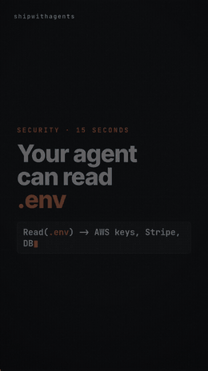

# sinereel

Render a vertical social reel — **the picture and the soundtrack** — entirely from code.
Headless Chromium draws the frames. ~100 lines of numpy write the music. ffmpeg glues them together.

No editor, no motion-graphics app, no stock music licence, no cloud service.
One JSON file in, one `.mp4` out.



```bash
npm install
bash src/build.sh          # -> build/reel.mp4
```

```
→ frames
  370 frames in 153.7s -> build/frames
→ music
  build/music.wav — 15.4s, 5 scenes at 120 bpm
→ mux

  build/reel.mp4 — 2.7M
```

That output is real: it's the run that produced the GIF on the right.
1080×1920, 24 fps, 15.4 seconds, H.264 + AAC, ready to upload.

<br clear="right">

## Why this exists

Most programmatic-video tools ask you to learn a framework. Remotion wants React.
After Effects wants After Effects. Both are good, and both are more than you need
when the thing you're making is a 15-second card with big type, a code window,
and a beat under it.

sinereel is four files and a config. The scene is plain HTML and CSS — the thing
you already know how to style. Playwright steps through it one frame at a time.
That's the whole trick.

The part people don't expect is the audio.

## The soundtrack is code too

`src/audio.py` has no samples and no audio library. A kick is a sine wave whose
frequency decays from 118 Hz to 44 Hz in 35 milliseconds, plus a pop of noise:

```python
f = 118 * np.exp(-x / 0.035) + 44                      # pitch drop
body = np.sin(2 * np.pi * np.cumsum(f) / SR) * np.exp(-x / 0.16)
click = np.random.RandomState(1).randn(len(x)) * np.exp(-x / 0.004) * 0.25
```

A hi-hat is white noise, differentiated once to make it bright, with a 12 ms decay.
Reverb is the mix added back to itself twice, quieter and a little late. The whole
score is a drone, a four-note ostinato, and those two drum sounds.

Which means the music is **yours**, free of any licence, and — because it reads the
same config the picture does — it stays in sync by construction.

Every scene declares a `mood`:

```json
{ "type": "terminal", "dur": 3.2, "mood": "tension", ... }
```

| mood | what the music does |
|---|---|
| `intro` | drone only — no drums yet |
| `build` | kick, hats on the offbeat, ostinato |
| `tension` | drums drop out, low impact where the scene resolves |
| `payoff` | everything, kick at full |

Re-time a scene and the beat follows it. There is no audio to re-cut, ever.

## The config

```json
{
  "width": 1080, "height": 1920, "fps": 24,
  "brand": "yourhandle",
  "theme": { "bg": "#0B0C0E", "accent": "#E9713B", "...": "..." },
  "music": { "enabled": true, "bpm": 120, "root": 41.2 },
  "scenes": [ ... ]
}
```

Four scene types, each one a shape you actually use in a dev reel:

- **`title`** — kicker, big headline, optional sub and a monospace tag line
- **`code`** — a window that types your snippet out, with keywords highlighted
- **`terminal`** — a prompt that types, a result line, and a badge that fades in
- **`outro`** — closing headline, a question, your handle

In any text, `[[like this]]` paints accent and `{{like this}}` paints it dim.
Total duration is just the sum of the scenes' `dur`; nothing has to be declared twice.

## Files

| | |
|---|---|
| `src/scene.html` | builds the scene graph from the config, exposes `setT(seconds)` |
| `src/render.js` | drives `setT` frame by frame, screenshots each one |
| `src/audio.py` | the same config → `music.wav` |
| `src/build.sh` | render → music → ffmpeg |

Nothing animates on its own: `setT(t)` is a pure function of time, so frame 219 looks
the same whether you rendered it first or last. That's also why you can open
`scene.html` in a browser and scrub it by hand while you design.

## Requirements

Node 18+, Python 3 with numpy, ffmpeg. `npm install` pulls Playwright and the two
fonts; without the fonts it still renders, just with system faces.

If Playwright can't find a browser, point it at one:

```bash
CHROMIUM_PATH=/path/to/chrome bash src/build.sh
```

## Making it yours

Copy `reel.config.json`, change the hex codes in `theme`, put your own handle in
`brand`. The example is a real reel about a real thing — a `PreToolUse` hook that
stops a coding agent reading your `.env` before the read happens.

```bash
bash src/build.sh my-reel.json build/my-reel.mp4
```

## Licence

MIT. The renders are yours, music included.
